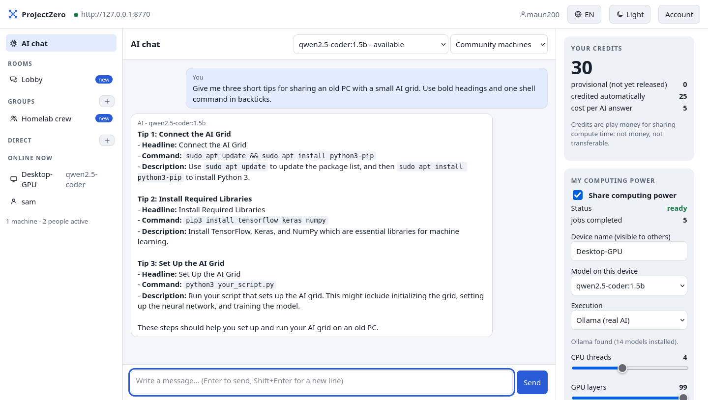

# ProjectZero

**Bündle die freien Rechner in deinem Zuhause, Verein oder deiner Community zu einem kleinen KI-Netz.**
Chatte mit einer KI, die auf den Rechnern deiner Gruppe läuft, verdiene Credits, indem du
deinen eigenen Computer teilst, und schreib mit den anderen in der Lobby, in Gruppen oder direkt.

[English](README.md) · [Mitmachen](CONTRIBUTING.md) · [Sicherheit](docs/SECURITY.md) · [Roadmap](docs/ROADMAP.md) · [Vision](#wohin-es-geht-ein-globales-community-netz) · MIT-Lizenz



> **Status: experimentell (v0.3).** Funktioniert heute im Heimnetz und ist auf Linux, macOS
> und Windows getestet. Es ist kein abgesicherter öffentlicher Dienst. Anfragen kann die
> rechnende Maschine und der Server-Betreiber lesen. Credits sind Spielgeld, kein Geld.
> Siehe [Was es nicht ist](#was-es-nicht-ist).

## Was du bekommst

- **KI-Chat, der Credits kostet.** Jede Antwort kostet ein paar Credits und wird von einer
  der Maschinen berechnet, die gerade online sind. Du siehst, welche Modelle verfügbar sind.
- **Credits fürs Teilen deines Rechners.** Schalte „Rechenleistung teilen“ ein und dein PC
  beantwortet Anfragen anderer, während du ihn nicht brauchst. Dein Guthaben steht immer rechts.
- **Du entscheidest, wie viel du teilst.** Regler für CPU-Threads, GPU-Schichten,
  Antwortlänge und Kontext. Änderungen gelten sofort.
- **Lobby, Gruppen und Direktnachrichten** mit allen auf demselben Server, dazu eine Liste
  der Maschinen und Menschen, die gerade online sind.
- **Englisch und Deutsch**, helles und anthrazitfarbenes Design, auch fürs Handy-Format.
- **Eigener Server mit einem Befehl** für Familie, WG oder Verein.

## Installation

Du brauchst Python 3.11 oder neuer. Der Installer legt eine eigene Umgebung in deinem
Benutzerordner an, braucht keine Administratorrechte und ändert nichts am System.

**Linux und macOS**

```sh
curl -fsSL https://raw.githubusercontent.com/maun200/ProjectZero/main/install.sh | sh
```

**Windows (PowerShell)**

```powershell
irm https://raw.githubusercontent.com/maun200/ProjectZero/main/install.ps1 | iex
```

Die App öffnet sich im Browser. Später startest du sie wieder mit `projectzero`.
Du liest Skripte lieber vorher? Lade `install.sh` / `install.ps1` erst herunter oder installiere
von Hand mit `pip install https://github.com/maun200/ProjectZero/archive/refs/heads/main.tar.gz`.

## In zwei Minuten ausprobieren, ganz ohne KI-Modell

```sh
projectzero demo
```

Das startet einen privaten Server und die App nur auf deinem Rechner. Leg ein Konto an,
schalte „Rechenleistung teilen“ mit Ausführung „Demo“ ein und frag die KI etwas. Die Antwort
ist ein Platzhalter, alles andere ist echt: Warteschlange, dein Rechner holt sich die Aufgabe,
Credits.

## Einem Server beitreten und echte KI teilen

1. Frag den Betreiber des Servers deiner Gruppe nach der Adresse, zum Beispiel
   `http://192.168.1.10:8765` im Heimnetz oder eine `https://`-Adresse im Internet.
2. Starte `projectzero`, gib die Adresse ein und wähle einen Anzeigenamen.
3. Um deinen Rechner zu teilen, installiere [Ollama](https://ollama.com), wähle eines der
   erlaubten Modelle und schalte „Rechenleistung teilen“ ein. Die App kann das Modell für dich
   herunterladen.

## Eigenen Server betreiben

```sh
projectzero server --lan --models qwen2.5-coder:1.5b
```

Der Server legt seine Schlüssel in deinem Benutzerordner ab (nur für dich lesbar) und erlaubt
standardmäßig die Selbst-Registrierung. Nützliche Optionen:

| Option | Bedeutung |
| --- | --- |
| `--lan` | im lokalen Netz erreichbar (sonst nur dieser Rechner) |
| `--registration open\|invite\|off` | wer ein Konto anlegen darf; `invite` braucht Codes von `POST /api/admin/invites` |
| `--models a,b` | Modelle, die Mitglieder nutzen und teilen dürfen |
| `--auto-settle` | Credits für erledigte Aufgaben sofort gutschreiben (niemand prüft die Antworten!) |
| `--signup-credits N` | Start-Credits für neue Mitglieder |

Für einen Dauerbetrieb gibt es ein gehärtetes Docker-Setup:

```sh
cp .env.example .env    # zwei zufällige Schlüssel setzen, dazu CAG_REGISTRATION / CAG_ALLOWED_MODELS
docker compose up -d --build
```

Den Server nicht ohne HTTPS-Reverse-Proxy ins Internet stellen und vorher
[docs/SECURITY.md](docs/SECURITY.md) lesen.

## So funktioniert es

```
 dein Browser ── lokale App (127.0.0.1) ──┐
                                          │  HTTPS oder privates Netz
 Apps der anderen Mitglieder ────────────►  Coordinator (FastAPI + SQLite)
                                          │   Warteschlange, Konten, Credits, Chat
 Rechner, die Leistung teilen ◄── holen ──┘
   └─ lokales Modell über Ollama (nie im Netz erreichbar)
```

- Worker **holen** sich Aufgaben; der Server verbindet sich nie in deinen Rechner und schickt
  nie Code zum Ausführen. Ein Worker gibt nur den Anfragetext an dein gewähltes lokales Modell.
- Jede Aufgabe geht an eine Maschine, die das ganze Modell hat. Ein großes Modell auf viele
  Rechner zu verteilen ist Forschung, keine Funktion (siehe [docs/RESEARCH_GLOBAL_GRID.md](docs/RESEARCH_GLOBAL_GRID.md)).
- Leases, Heartbeats, Wiederholungen und Erstattungen halten Aufgaben in Bewegung, wenn eine
  Maschine verschwindet.
- `privacy=trusted`-Aufgaben gehen nur an Maschinen, die der Betreiber als vertrauenswürdig
  markiert hat; wer sich über die App registriert, ist eine `community`-Maschine.

## Wohin es geht: ein globales Community-Netz

ProjectZero fängt bewusst klein an: ein Server für einen Haushalt, einen Verein oder einen
Freundeskreis. Das langfristige Ziel ist größer: **ein weltweites KI-Netz, das der Community
gehört und eine echte Alternative zu kommerziellen KI-Anbietern ist.** Menschen überall bringen
Hardware ein, die sie ohnehin besitzen, und das Netz hängt von keiner einzelnen Firma und keinem
einzelnen Server ab.

Der Weg dahin ist Föderation, ähnlich wie bei E-Mail oder Matrix: viele unabhängige Server,
jeder von seiner eigenen Community betrieben, die sich gegenseitig Arbeit abgeben, wenn sie
ausgelastet sind, und Credits untereinander verrechnen. Eine einzelne Antwort wird nicht so
schnell sein wie aus einem Rechenzentrum. Dafür kann das Netz fast kostenlos sein (die
Hauptkosten sind der Strom für Hardware, die es schon gibt), unabhängig und offen.

**Nichts davon gibt es schon.** Heute steht jeder Server für sich. Die Schritte dorthin stehen
in Phase 3 der [Roadmap](docs/ROADMAP.md#phase-3---global-community-grid-long-term-goal) und
werden in [docs/RESEARCH_GLOBAL_GRID.md](docs/RESEARCH_GLOBAL_GRID.md) ausgearbeitet. Wer dabei
mitbauen will, fängt am besten dort an.

## Was es nicht ist

- **Nicht privat.** Anfragen und Chats liegen unverschlüsselt auf dem Server und die rechnende
  Maschine kann die Anfrage lesen. Keine persönlichen oder geheimen Daten senden.
- **Nicht geprüft.** Niemand kontrolliert, ob eine Antwort ehrlich berechnet wurde. Mit
  `--auto-settle` werden Credits ohne jede Prüfung gutgeschrieben.
- **Kein Geld.** Credits regeln nur, wer wie viel Rechenzeit nutzen darf. Man kann sie nicht
  kaufen, verkaufen oder übertragen.
- **Noch kein öffentlicher Dienst.** Missbrauchsschutz gibt es nur über Rate-Limits,
  Einladungscodes und eine Sperrfunktion für Admins.

## Entwicklung

```sh
git clone https://github.com/maun200/ProjectZero && cd ProjectZero
python -m venv .venv && . .venv/bin/activate
pip install -e '.[test]'
pytest -q
```

Aufbau: `coordinator/` (Server), `worker/` (Aufgaben-Ausführung), `projectzero/` (lokale App
und CLI), `gui/` (optionale Tray-App für Worker ohne Bildschirm), `scripts/` (Admin- und
Geräte-Helfer), `tests/`. Mehr in [CONTRIBUTING.md](CONTRIBUTING.md) und
[docs/ARCHITECTURE.md](docs/ARCHITECTURE.md).

Fehlerberichte, Geräteberichte (welche Hardware welches Modell wie schnell rechnet) und
Pull-Requests sind sehr willkommen.

## Lizenz

MIT, erstellt von maun200. Du darfst es nutzen, ändern und weitergeben, solange der
Urheberrechtshinweis dabei bleibt. Siehe [LICENSE](LICENSE).
