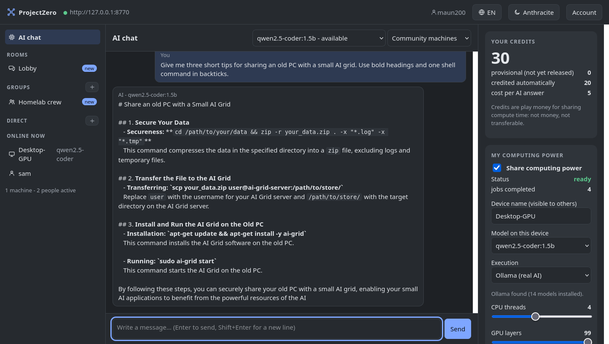

# ProjectZero

**Pool the spare computers in your home, club or community into one small AI grid.**
Chat with an AI that runs on your group's machines, earn credits by sharing your own
computer, and talk to each other in a lobby, in groups or directly.

[Deutsch](README.de.md) · [Contributing](CONTRIBUTING.md) · [Security](docs/SECURITY.md) · [Roadmap](docs/ROADMAP.md) · MIT license



> **Status: experimental (v0.3).** It works on a home network today and is tested on Linux,
> macOS and Windows. It is not a hardened public service. Requests are readable by the machine
> that computes them and by whoever runs the server. Credits are play money, not money.
> See [what it is not](#what-it-is-not).

## What you get

- **AI chat that spends credits.** Every answer costs a few credits and is computed by one of
  the machines that are online right now. You see which models are available.
- **Credits for sharing your computer.** Switch on "Share computing power" and your PC answers
  other people's requests while you are not using it. Your balance is always visible on the
  right.
- **You decide how much you share.** Sliders for CPU threads, GPU layers, answer length and
  context size. Changes apply immediately.
- **Lobby, groups and direct messages** with everyone on the same server, plus a list of the
  machines and people online.
- **English and German**, light and anthracite theme, works on a phone-sized screen.
- **Self-hosting in one command.** Run your own server for your family, flat share or club.

## Install

You need Python 3.11 or newer. The installer creates its own environment in your user folder,
needs no administrator rights and changes nothing system-wide.

**Linux and macOS**

```sh
curl -fsSL https://raw.githubusercontent.com/maun200/ProjectZero/main/install.sh | sh
```

**Windows (PowerShell)**

```powershell
irm https://raw.githubusercontent.com/maun200/ProjectZero/main/install.ps1 | iex
```

The app opens in your browser. Start it again later with `projectzero`.
Prefer to read a script before running it? Download `install.sh` / `install.ps1` first, or
install manually with `pip install https://github.com/maun200/ProjectZero/archive/refs/heads/main.tar.gz`.

## Try it in two minutes, without any AI model

```sh
projectzero demo
```

This starts a private server and the app on your computer only. Create an account, switch on
"Share computing power" with execution "Demo", then ask the AI something. The answer is a
placeholder, but everything else is real: queueing, your machine picking up the job, credits.

## Join a server and share real AI

1. Ask whoever runs your group's server for its address, for example `http://192.168.1.10:8765`
   on your home network, or an `https://` address on the internet.
2. Start `projectzero`, enter the address, choose a display name.
3. To share your computer, install [Ollama](https://ollama.com), pick one of the models the
   server allows and switch on "Share computing power". The app can download the model for you.

## Run your own server

```sh
projectzero server --lan --models qwen2.5-coder:1.5b
```

The server stores its keys in your user folder (readable only by you) and allows
self-registration by default. Useful options:

| Option | Meaning |
| --- | --- |
| `--lan` | reachable from your local network (default: this computer only) |
| `--registration open\|invite\|off` | who can create an account; `invite` needs codes from `POST /api/admin/invites` |
| `--models a,b` | the models members may use and share |
| `--auto-settle` | credit finished jobs to the machine owner immediately (nobody checks the answers!) |
| `--signup-credits N` | credits a new member starts with |

For an always-on server there is a hardened Docker setup:

```sh
cp .env.example .env    # then set two random keys and CAG_REGISTRATION / CAG_ALLOWED_MODELS
docker compose up -d --build
```

Do not put the server on the internet without an HTTPS reverse proxy and reading
[docs/SECURITY.md](docs/SECURITY.md).

## How it works

```
 your browser ── local app (127.0.0.1) ──┐
                                         │  HTTPS or private network
 other members' apps ───────────────────►  coordinator (FastAPI + SQLite)
                                         │   queue, accounts, credits, chat
 machines sharing compute ◄──── pull ────┘
   └─ local model via Ollama (never exposed to the network)
```

- Workers **pull** jobs; the server never connects into your computer and never sends code
  to run. A worker only feeds the request text to the local model you picked.
- Each job goes to one machine that has the whole model. Splitting one big model across
  many machines is research, not a feature (see [docs/RESEARCH_GLOBAL_GRID.md](docs/RESEARCH_GLOBAL_GRID.md)).
- Leases, heartbeats, retries and refunds keep jobs moving when a machine disappears.
- `privacy=trusted` jobs only go to machines the operator marked as trusted; everyone who
  registers through the app is a `community` machine.

## What it is not

- **Not private.** Prompts and chats are stored unencrypted on the server and the computing
  machine can read the request. Do not send personal or secret data.
- **Not verified.** Nobody checks that an answer was computed honestly. With `--auto-settle`
  credits are paid without any check.
- **Not money.** Credits only decide who may use how much compute. They cannot be bought,
  sold or transferred.
- **Not a public service yet.** There is no abuse protection beyond rate limits, invite codes
  and an admin block function.

## Development

```sh
git clone https://github.com/maun200/ProjectZero && cd ProjectZero
python -m venv .venv && . .venv/bin/activate
pip install -e '.[test]'
pytest -q
```

Project layout: `coordinator/` (server), `worker/` (job runner), `projectzero/` (local app and
CLI), `gui/` (optional tray app for headless workers), `scripts/` (admin and device helpers),
`tests/`. More in [CONTRIBUTING.md](CONTRIBUTING.md) and [docs/ARCHITECTURE.md](docs/ARCHITECTURE.md).

Bug reports, device reports (which hardware runs which model how fast) and pull requests are
very welcome.

## License

MIT, created by maun200. You may use, change and share it as long as the copyright notice
stays with it. See [LICENSE](LICENSE).
